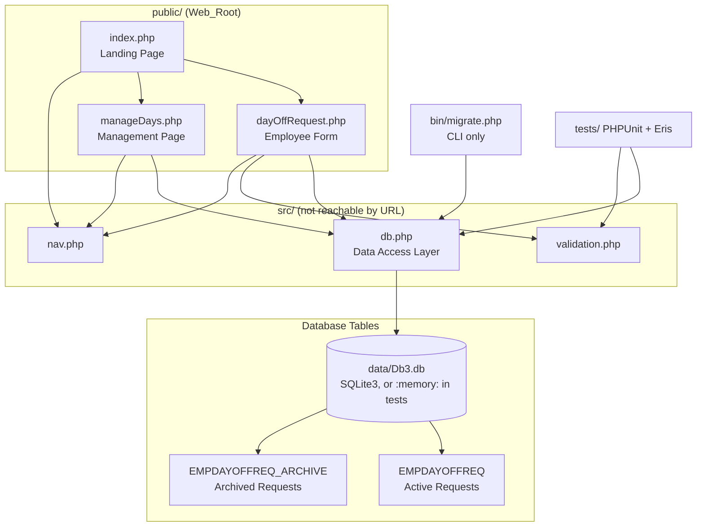
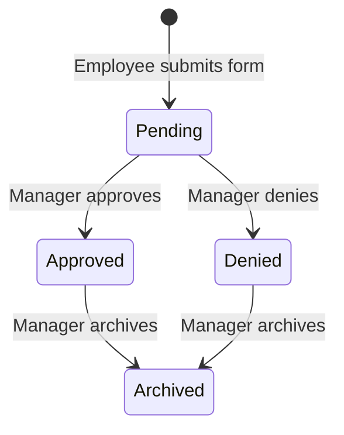
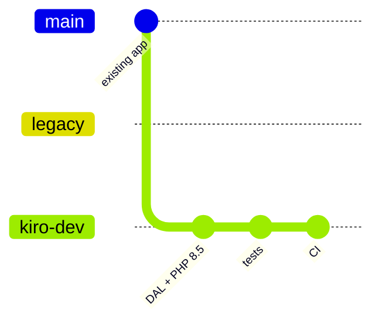

# Design Document: Day-Off Request System

## Overview

This design describes an employee day-off request system built with vanilla PHP and SQLite3. The system replaces paper-based day-off requests with a web workflow where employees submit requests via a form and managers review, approve or deny, and archive them through a management page.

The system runs on a local network without authentication (honor system). It has three pages: a landing page, an employee request form, and a management page.

This revision adds engineering requirements (Requirements 8 to 13): a supported PHP version (8.5 or later), a `legacy` branch that preserves the pre-upgrade code, a PHPUnit and Eris test suite, GitHub Actions CI, a Data Access Layer (DAL) that isolates all database-engine code in `src/db.php`, and a web root separation that places only browser-facing files in `public/`.

### Key Design Decisions

1. **Parameterized queries everywhere.** The original code interpolates strings into SQL (SQL injection risk). All operations use prepared statements with bound parameters.
2. **Archive is a table in the same database file.** The requirements glossary defines the Archive_Database as "a separate SQLite database". This design implements it as a second table, `EMPDAYOFFREQ_ARCHIVE`, inside `data/Db3.db`. Reasons: the move can be a single atomic transaction (a cross-file move would need `ATTACH` and is not atomic across WAL files), backup is one file, and Requirement 5.3 (rollback on failure) stays simple. Requirement 6.2 (same schema plus ARCHIVED_DATE) and Requirements 5.1 to 5.3 are satisfied. Where the requirements say "Archive_Database", read "archive table". If a physically separate file is required, requirements.md should be changed; this design does not assume that.
3. **Server-side validation only.** There is no JavaScript framework, so PHP validates on submission.
4. **Status-based workflow.** Requests flow Pending, then Approved or Denied, then Archived.
5. **Shared layout via PHP includes.** `src/nav.php` provides the sidebar on every page.
6. **Isolated Data Access Layer (Req 12).** `src/db.php` is the only file that constructs a connection or contains engine-specific SQL. Pages and tests call DAL functions. This keeps a later move to MySQL or MariaDB limited to one file (the migration itself is out of scope).
7. **E_ALL clean code (Req 8).** Code is written so that no deprecation notice or warning is emitted under `error_reporting(E_ALL)` on PHP 8.5 or later. Tests and CI enforce this.
8. **Web root separation (Req 13).** Only four browser-facing files live in `public/`, and the server is started with `php -S localhost:8000 -t public`. Serving from the repository root exposed `Db3.db` (employee names, phones, and reasons) for download, let `migrate.php` run from a browser, and made `composer.json`, `docs/`, `.kiro/`, `vendor/`, and `tests/` readable by URL. With `public/` as the document root, none of those paths map to a file, so the response contains none of the requested file's contents and the script is not executed. Under `php -S`, a URI that does not map to a file in `public/` is answered by `public/index.php` (HTTP 200, the home page), so the status is not 404 there; Apache or nginx with `DocumentRoot` or `root` set to `public/` return a real 404. Rationale for the alternatives: an `.htaccess` deny list works only on Apache and fails open if a file is forgotten, and a router script for the built-in server was considered and rejected because it would only change the status code, not the security outcome. A directory boundary needs no per-file rules. The same layout carries over to Apache or nginx by pointing `DocumentRoot` or `root` at `public/` (later LAMP work, out of scope now). **Validates: Requirements 13.1 to 13.5, 13.7**

## Architecture



Pages never call `new SQLite3(...)`, never run `PRAGMA`, and never use `datetime('now','localtime')`. They call DAL functions only.

### Project Layout and Web Root Separation (Req 13)

```
DayOffRequest_V1/
├── public/                 # Web_Root: the only directory served to browsers
│   ├── index.php
│   ├── dayOffRequest.php
│   ├── manageDays.php
│   └── styles.css
├── src/                    # includes, not reachable by URL
│   ├── db.php              # Data Access Layer
│   ├── validation.php
│   └── nav.php
├── bin/
│   └── migrate.php         # CLI-only migration
├── data/
│   └── Db3.db              # SQLite database (tracked in git)
├── tests/
├── vendor/
├── docs/
├── .kiro/
├── composer.json
├── composer.lock
└── phpunit.xml
```

`public/` contains exactly the four files shown (Req 13.1). `src/` holds `db.php`, `validation.php`, and `nav.php` (Req 13.2). `bin/` holds `migrate.php` (Req 13.3). `data/` holds the Database_File (Req 13.4). `tests/`, `vendor/`, `docs/`, `.kiro/`, `composer.json`, `composer.lock`, and `phpunit.xml` stay at the Repository_Root, outside the Web_Root (Req 13.5).

**Path rules**

- Public pages include `src/` files with `__DIR__`, for example `require_once __DIR__ . '/../src/db.php';`, `require_once __DIR__ . '/../src/validation.php';`, and `require_once __DIR__ . '/../src/nav.php';` (Req 13.8).
- Files in `src/` include each other with `__DIR__`, for example `require_once __DIR__ . '/validation.php';` (Req 13.9). Because every path is anchored to `__DIR__`, pages load from any current working directory (Req 13.10).
- `src/db.php` defines `const DEFAULT_DB_PATH = dirname(__DIR__) . '/data/Db3.db';` (Req 13.11).
- Links in `nav.php` are relative to `public/`, for example `index.php`, `dayOffRequest.php`, and `manageDays.php`, so they resolve to the Web_Root pages when served with `-t public` (Req 13.18).
- Public pages link the stylesheet as `styles.css` unchanged, because the page and stylesheet are siblings in `public/`.

**Running the application**

```bash
php -S localhost:8000 -t public   # run from the Repository_Root (Req 13.6)
```

Requests for `/Db3.db`, `/data/Db3.db`, `/db.php`, `/src/db.php`, `/migrate.php`, `/bin/migrate.php`, and `/composer.json` return none of the requested file's contents and execute no script, because none of those files exist under `public/` (Req 13.7). Under `php -S`, these URIs are answered by `public/index.php` (HTTP 200, the home page) rather than 404; Apache or nginx with the document root set to `public/` return real 404s. For Apache or nginx later, set `DocumentRoot` or `root` to the absolute path of `public/`.

**Repository changes**

- Files are moved with `git mv` so that history is preserved: `index.php`, `dayOffRequest.php`, `manageDays.php`, `styles.css` into `public/`; `db.php`, `validation.php`, `nav.php` into `src/`; `migrate.php` into `bin/`; `Db3.db` into `data/`.
- `.gitignore` keeps the existing `*.db` rule, and `data/Db3.db` stays tracked (added with `git add -f` or an existing tracked entry carried by `git mv`). It adds `data/*.db-wal` and `data/*.db-shm` so SQLite write-ahead log files are not committed. The glob `*.db` does not match `.db-wal` or `.db-shm`, so the new rules are required.
- After the move, `./vendor/bin/phpunit` and the CI workflow must pass using the new paths (Req 13.14, 13.15). `tests/bootstrap.php` requires `../src/db.php` and `../src/validation.php`, and `composer.json` needs no change, since it has no autoload entries pointing at moved files.

**Validates: Requirements 13.1 to 13.11, 13.14, 13.15, 13.18**

### Request Lifecycle



### Repository and Branch Strategy (Req 9)



- `legacy` is created from `master` at its current commit (`git branch legacy master`) before any work begins, so both point to the same commit (Req 9.1, 9.2).
- All work for Requirements 8 to 12 is committed on `kiro-dev` (Req 9.3). `legacy` receives no new commits (Req 9.4).
- `master` is only updated by merging `kiro-dev` after review.
- The mermaid diagram labels the primary branch `main` for rendering only. The actual branch name is `master`.

### Supported PHP Version (Req 8)

- `composer.json` declares `"require": { "php": ">=8.5", "ext-sqlite3": "*" }` (Req 8.1, 8.4).
- 8.5 is the minimum. It is the newest supported branch, and 8.5.12 is the latest security release (21 Oct 2026). The minimum was raised for security reasons.
- Only the `sqlite3` extension is used for database access. No PDO and no `mysqli` (Req 8.4).
- The README documents the minimum PHP version and required extensions (`sqlite3`, plus `mbstring` if used), and how to run the app when `php` is not on the PATH, for example by calling the executable with its full path: `C:\path\to\php\php.exe -S localhost:8000 -t public` from the repository root. The README also documents the directory layout (Req 8.5, 8.6, 13.6, 13.17).

### E_ALL Clean Code (Req 8.2, 8.3)

Coding rules that keep the code free of notices on PHP 8.5 or later:

- Read `$_POST` and `$_GET` values with `?? ''` (no undefined-index warnings).
- Declare parameter and return types. Do not pass `null` to string functions (deprecated since 8.1). Cast with `(string)` or default with `??`.
- No dynamic properties on classes, no `${var}` string interpolation, no implicit nullable parameter types (`Type $x = null`; write `?Type $x = null`).
- Check `SQLite3::prepare()` and `execute()` results. They return `false` on failure, and use of the `false` value produces errors.
- Escape output with `htmlspecialchars($v, ENT_QUOTES, 'UTF-8')`.

## Components and Interfaces

### 1. Data Access Layer (`src/db.php`)

The only file that names the database engine (Req 12.1, 12.2). It accepts the database location as a parameter (Req 12.4). The default location is resolved from the file's own directory, so it does not depend on the working directory (Req 13.11).

```php
declare(strict_types=1);

const DEFAULT_DB_PATH = dirname(__DIR__) . '/data/Db3.db';

/** Open a connection. $path may be ':memory:' (tests). */
function getDb(string $path = DEFAULT_DB_PATH): SQLite3;

/** Create EMPDAYOFFREQ and EMPDAYOFFREQ_ARCHIVE if missing (used by tests and bin/migrate.php). */
function createSchema(SQLite3 $db): void;

/** Insert a request; STATUS and SUBMITTED_DATE come from column defaults. Returns the new NUM. */
function insertRequest(SQLite3 $db, array $data): int;

/** @return array<int, array<string,mixed>> rows with STATUS = 'Pending' */
function getPendingRequests(SQLite3 $db): array;

/** @return array<int, array<string,mixed>> rows with STATUS IN ('Approved','Denied') */
function getHistoryRequests(SQLite3 $db): array;

function getRequestById(SQLite3 $db, int $num): ?array;

/** $status must be 'Approved' or 'Denied'. Returns true if a row changed. */
function updateRequestStatus(SQLite3 $db, int $num, string $status): bool;

/** Move an Approved/Denied row to the archive table in one transaction. Returns false and rolls back on failure. */
function archiveRequest(SQLite3 $db, int $num): bool;

function countRequests(SQLite3 $db): int;
function getArchivedRequestById(SQLite3 $db, int $num): ?array;
```

Engine-specific content kept inside `src/db.php`:

- `new SQLite3($path)`, `busyTimeout(5000)`, `PRAGMA journal_mode = WAL` (skipped for `:memory:`, where WAL does not apply), and optionally `PRAGMA foreign_keys`.
- `datetime('now','localtime')` in column defaults and in the archive insert (`ARCHIVED_DATE`).
- `BEGIN TRANSACTION` / `COMMIT` / `ROLLBACK`.
- `ALTER TABLE ... ADD COLUMN` and `PRAGMA table_info` used by the migration helper.

Design note on `ALTER TABLE ADD COLUMN`: SQLite rejects a non-constant default such as `datetime('now','localtime')` when adding a column. The migration helper therefore adds `SUBMITTED_DATE` with a constant default (existing rows get a placeholder such as the migration time, set in a follow-up `UPDATE`), or rebuilds the table by copying rows to a new table. `createSchema()` uses the full definition for new databases.

Archive implementation (all engine SQL stays in the DAL):

```php
function archiveRequest(SQLite3 $db, int $num): bool {
    $db->exec('BEGIN TRANSACTION');
    try {
        $ins = $db->prepare(
            "INSERT INTO EMPDAYOFFREQ_ARCHIVE
               (NUM, NAME, PHONE, SHIFTS, SUB, REASON, STATUS, SUBMITTED_DATE, ARCHIVED_DATE)
             SELECT NUM, NAME, PHONE, SHIFTS, SUB, REASON, STATUS, SUBMITTED_DATE, datetime('now','localtime')
             FROM EMPDAYOFFREQ WHERE NUM = :n AND STATUS IN ('Approved','Denied')"
        );
        // bind, execute; throw on failure or when zero rows were inserted
        // prepare + execute DELETE FROM EMPDAYOFFREQ WHERE NUM = :n
        $db->exec('COMMIT');
        return true;
    } catch (Throwable $e) {
        $db->exec('ROLLBACK');
        return false;
    }
}
```

Test seam: `archiveRequest` receives the connection, so a test can drop `EMPDAYOFFREQ_ARCHIVE` first to force a failure and then assert the active row remains (Req 5.3, 10.4).

Validation lives outside the DB code, in a small pure function so it can be tested without a database. It is placed in `src/validation.php` (no SQL, so it is not part of the DAL):

```php
const ALLOWED_REASONS = ['Medical', 'Dental', 'Family Emergency', 'Personal', 'Other'];

/** @return array<string,string> field => error message; empty array means valid */
function validateRequest(array $input): array;
```

### 2. Navigation Include (`src/nav.php`)

Sidebar rendered on every page with links to Home, Request Day Off, and View Days Off (Req 7.1). The links are relative to `public/` (`index.php`, `dayOffRequest.php`, `manageDays.php`) so they resolve when served with `-t public` (Req 13.18). Header and footer styling comes from `public/styles.css`, linked as `styles.css` (Req 7.2).

### 3. Request Form Page (`public/dayOffRequest.php`)

- Includes `../src/db.php`, `../src/validation.php`, and `../src/nav.php` through `__DIR__` paths (Req 13.8).
- Renders fields: name, phone, shifts, substitute, and a reason dropdown (Medical, Dental, Family Emergency, Personal, Other).
- On POST: `validateRequest()`. On errors, shows messages and preserves entered values. On success, calls `insertRequest()` and shows a confirmation.
- Gets its connection by calling `getDb()`.
- Input: POST `name`, `phone`, `shifts`, `sub`, `reason`.

### 4. Management Page (`public/manageDays.php`)

- Includes `../src/db.php` and `../src/nav.php` through `__DIR__` paths (Req 13.8).
- Pending view (default) and history view via GET `view` (`pending` or `history`).
- POST actions `approve`, `deny`, `archive` with request `id`, using `updateRequestStatus()` and `archiveRequest()`, then POST-Redirect-GET.
- On archive failure: shows an error message and the record stays in the active table.
- Shows "no pending requests" when the pending list is empty.

### 5. Migration Script (`bin/migrate.php`)

One-time script that upgrades an existing `data/Db3.db`: adds `STATUS` and `SUBMITTED_DATE` when missing, then creates the archive table. It calls a DAL migration function (`migrateSchema(SQLite3 $db)`) and holds no engine SQL itself. It is safe to run more than once.

- It requires the DAL with `require_once __DIR__ . '/../src/db.php';`.
- Its first action is a SAPI guard, before the DAL is used and before any database is opened: when `PHP_SAPI !== 'cli'` it prints a message and exits with a non-zero code, leaving `Db3.db` untouched (Req 13.12).
- Run from the command line it migrates `data/Db3.db` (Req 13.13): `php bin/migrate.php`.
- It lives outside `public/`, so the built-in server cannot serve it. The SAPI guard is a second layer in case the file is ever copied into a web-served directory.

```php
<?php
declare(strict_types=1);

if (PHP_SAPI !== 'cli') {
    http_response_code(403);
    echo "migrate.php can only be run from the command line.\n";
    exit(1);
}

require_once __DIR__ . '/../src/db.php';
```

**Validates: Requirements 13.3, 13.12, 13.13**

### 6. Test Suite (`tests/`)

```
composer.json
phpunit.xml
tests/
  bootstrap.php            # error_reporting(E_ALL); requires ../src/db.php and ../src/validation.php; autoload
  DbTestCase.php           # base class: setUp() opens getDb(':memory:') and calls createSchema()
  Generators.php           # Eris generators: valid request data, SQL-metacharacter strings, blank fields
  Unit/
    ValidationTest.php     # form validation examples (Req 10.4)
    DefaultStatusTest.php  # Pending default (Req 10.4)
    EmptyPendingTest.php   # empty pending list state (Req 10.4)
    ArchiveRollbackTest.php# archive failure keeps the record (Req 10.4)
    DalIsolationTest.php   # static check, see below
    SchemaTest.php         # columns and defaults (Req 6.1, 6.2)
  Property/
    ...one Eris test per correctness property
```

`phpunit.xml`:

- `bootstrap="tests/bootstrap.php"`, test directory `tests`.
- `failOnWarning="true"`, `failOnDeprecation="true"`, `failOnNotice="true"`, `failOnRisky="true"`, `convertDeprecationsToExceptions` equivalent via the failOn settings (PHPUnit 10 and later).
- `<ini name="error_reporting" value="-1"/>` and `<ini name="display_errors" value="1"/>` so E_ALL is active (Req 11.7).
- `cacheDirectory` set to `.phpunit.cache` (added to `.gitignore`).

`DalIsolationTest` (the existing file is `tests/Unit/DataAccessIsolationTest.php`) scans every `*.php` file in `public/`, `src/`, and `bin/`, excluding `src/db.php`, and asserts that none contains `new SQLite3`, `PRAGMA`, or `datetime(` (Req 12.1 to 12.3, 13.16). Paths are built from `dirname(__DIR__, 2)` so the test works from any working directory. `tests/` is not scanned.

Tests never open `data/Db3.db`: the base class always passes `':memory:'` (Req 10.2). `composer.json` lists `phpunit/phpunit` and `giorgiosironi/eris` under `require-dev` (Req 10.7). The suite runs with `./vendor/bin/phpunit` from the repository root (Req 10.1). PHPUnit exits non-zero on any failure (Req 10.6).

### 7. Continuous Integration (`.github/workflows/tests.yml`)

```yaml
name: Tests

on:
  push:
    branches: [master, kiro-dev, legacy]
  pull_request:

jobs:
  phpunit:
    name: PHPUnit (PHP ${{ matrix.php }})
    runs-on: ubuntu-latest
    strategy:
      fail-fast: false
      matrix:
        php: ['8.5']
    steps:
      - name: Checkout
        uses: actions/checkout@v5

      # The legacy branch has no composer.json or tests, so the remaining steps are skipped there.
      - name: Set up PHP
        if: ${{ hashFiles('composer.json') != '' }}
        uses: shivammathur/setup-php@v2
        with:
          php-version: ${{ matrix.php }}
          extensions: sqlite3, mbstring
          coverage: none

      - name: Install dependencies
        if: ${{ hashFiles('composer.json') != '' }}
        run: composer install --no-interaction --prefer-dist --no-progress

      - name: Run tests
        if: ${{ hashFiles('composer.json') != '' }}
        run: php -d error_reporting=-1 vendor/bin/phpunit
```

- Triggers: push to `master`, `kiro-dev`, and `legacy`, and pull requests (Req 11.2, 11.3). Pull request events default to `opened`, `synchronize`, and `reopened`.
- The job matrix has a single entry, `php: ['8.5']`, with `fail-fast: false`, so more versions can be added later without changing the job.
- The checkout step uses `actions/checkout@v5`. `shivammathur/setup-php@v2` installs PHP 8.5 with the `sqlite3` and `mbstring` extensions and `coverage: none`. Composer dependencies are then installed with `composer install --no-interaction --prefer-dist --no-progress` before tests run (Req 11.4, 11.5).
- Tests run with `php -d error_reporting=-1 vendor/bin/phpunit`. A non-zero PHPUnit exit fails the step and the run (Req 11.6).
- `error_reporting=-1` (all errors) together with `failOnDeprecation` and `failOnWarning` in `phpunit.xml` makes deprecations and warnings fail the run (Req 11.7).
- Every step except checkout is guarded by `if: ${{ hashFiles('composer.json') != '' }}`. The `legacy` branch has no `composer.json`, so on `legacy` the job only checks out and passes without testing.
- GitHub runs the workflow file from the pushed branch. `legacy` has no workflow file, so pushes to `legacy` do not trigger CI at all. Req 9.4 keeps `legacy` free of new commits, so the file is not added there. The `legacy` entry in the trigger list and the `hashFiles` guards are harmless safeguards in case the file ever reaches that branch. This is a known tension between Req 9.4 and Req 11.2.

## Data Models

### EMPDAYOFFREQ Table

| Column | Type | Constraints |
|--------|------|-------------|
| NUM | INTEGER | PRIMARY KEY AUTOINCREMENT |
| NAME | TEXT | NOT NULL |
| PHONE | TEXT | NOT NULL |
| SHIFTS | TEXT | NOT NULL |
| SUB | TEXT | NOT NULL |
| REASON | TEXT | NOT NULL |
| STATUS | TEXT | NOT NULL DEFAULT 'Pending' |
| SUBMITTED_DATE | TEXT | NOT NULL DEFAULT (datetime('now','localtime')) |

### EMPDAYOFFREQ_ARCHIVE Table

| Column | Type | Constraints |
|--------|------|-------------|
| NUM | INTEGER | PRIMARY KEY |
| NAME | TEXT | NOT NULL |
| PHONE | TEXT | NOT NULL |
| SHIFTS | TEXT | NOT NULL |
| SUB | TEXT | NOT NULL |
| REASON | TEXT | NOT NULL |
| STATUS | TEXT | NOT NULL |
| SUBMITTED_DATE | TEXT | NOT NULL |
| ARCHIVED_DATE | TEXT | NOT NULL DEFAULT (datetime('now','localtime')) |

### Schema SQL (inside `src/db.php`)

```sql
CREATE TABLE IF NOT EXISTS EMPDAYOFFREQ (
    NUM INTEGER PRIMARY KEY AUTOINCREMENT,
    NAME TEXT NOT NULL,
    PHONE TEXT NOT NULL,
    SHIFTS TEXT NOT NULL,
    SUB TEXT NOT NULL,
    REASON TEXT NOT NULL,
    STATUS TEXT NOT NULL DEFAULT 'Pending',
    SUBMITTED_DATE TEXT NOT NULL DEFAULT (datetime('now','localtime'))
);

CREATE TABLE IF NOT EXISTS EMPDAYOFFREQ_ARCHIVE (
    NUM INTEGER PRIMARY KEY,
    NAME TEXT NOT NULL,
    PHONE TEXT NOT NULL,
    SHIFTS TEXT NOT NULL,
    SUB TEXT NOT NULL,
    REASON TEXT NOT NULL,
    STATUS TEXT NOT NULL,
    SUBMITTED_DATE TEXT NOT NULL,
    ARCHIVED_DATE TEXT NOT NULL DEFAULT (datetime('now','localtime'))
);
```

### Migration of an existing database

`migrateSchema()` checks `PRAGMA table_info(EMPDAYOFFREQ)` and adds only the missing columns. See the design note on `ALTER TABLE ADD COLUMN` in the DAL section for the `SUBMITTED_DATE` default.

## Correctness Properties

*A property is a characteristic or behavior that should hold true across all valid executions of a system—essentially, a formal statement about what the system should do. Properties serve as the bridge between human-readable specifications and machine-verifiable correctness guarantees.*

Redundancy review: criteria 1.1 and 6.3 merge into Property 1. Criteria 2.1 and 4.1 merge into Property 4. Criteria 3.1 and 3.2 merge into Property 5. Criteria 5.1 and 5.2 merge into Property 6. Property 1 asserts only the default status, so it does not duplicate the round-trip in Property 7. Criteria for PHP version, branches, CI, and DAL isolation are configuration or structural checks, so they are covered by smoke and example tests, not properties.

### Property 1: Valid submission defaults to Pending

*For any* valid form submission (all fields non-empty, reason from the allowed set), inserting the request without an explicit status SHALL result in a record with STATUS = "Pending".

**Validates: Requirements 1.1, 6.3**

### Property 2: SQL injection inputs stored literally

*For any* input string containing SQL metacharacters (quotes, semicolons, comment markers, DROP/DELETE statements), submitting that string as a field value SHALL store it verbatim without executing it as SQL, and the stored value SHALL equal the original input string.

**Validates: Requirements 1.2**

### Property 3: Empty field validation rejects submission

*For any* form submission where at least one required field (name, phone, shifts, substitute, reason) is empty or composed entirely of whitespace, the validation function SHALL reject the submission and the number of records in the database SHALL remain unchanged.

**Validates: Requirements 1.3**

### Property 4: Status filtering returns correct subset

*For any* set of requests with mixed statuses (Pending, Approved, Denied), querying for pending requests SHALL return only records with STATUS = "Pending", and querying for history SHALL return only records with STATUS in ("Approved", "Denied"). The union of both result sets SHALL equal the full set of records.

**Validates: Requirements 2.1, 4.1**

### Property 5: Status update preserves all other fields

*For any* pending request, updating its status to "Approved" or "Denied" SHALL change only the STATUS field, and NAME, PHONE, SHIFTS, SUB, REASON, and SUBMITTED_DATE SHALL remain identical to their values before the update.

**Validates: Requirements 3.1, 3.2**

### Property 6: Archive round-trip preserves data

*For any* approved or denied request, archiving it SHALL result in a record in the archive table whose NAME, PHONE, SHIFTS, SUB, REASON, STATUS, and SUBMITTED_DATE are identical to the original, and the record SHALL no longer exist in the active table.

**Validates: Requirements 5.1, 5.2**

### Property 7: Insert then read round-trip

*For any* valid request data, inserting a request and then reading it back SHALL return NAME, PHONE, SHIFTS, SUB, and REASON values equal to the inserted values.

**Validates: Requirements 10.5**

## Error Handling

### Form Validation Errors

| Scenario | Behavior |
|----------|----------|
| Required field empty or whitespace | Display inline error, do not insert, preserve other field values |
| Reason not in allowed list | Reject submission, display error |

### Database Errors

| Scenario | Behavior |
|----------|----------|
| Database file not writable | Display a user-friendly message, log details with `error_log()` |
| Prepare or execute returns `false` | DAL throws or returns a failure result; the page shows an error and does not continue |
| Archive insert or delete fails | Roll back, keep the record in the active table, display error message (Req 5.3) |
| Schema migration fails | Display error with instructions to check file permissions |
| Approve or deny on a missing or already-decided request | `updateRequestStatus()` returns false and the page shows an error message |

### Transaction Safety for Archive

`archiveRequest()` uses a transaction (see the DAL section), so either both the insert and the delete take effect or neither does.

## Testing Strategy

Property-based testing applies here because the core logic (validation, insert, filter, update, archive) consists of functions with clear inputs and outputs that run quickly against an in-memory database. Rendering, CI configuration, branch setup, and README content are verified with example, smoke, or manual checks.

### Unit and Example Tests

- Form validation examples, including blank, whitespace-only, and invalid reason values (Req 1.3, 10.4)
- Pending default status on insert without an explicit status (Req 6.3, 10.4)
- Empty pending list returns an empty result and the page shows the empty message (Req 2.3, 10.4)
- Archive rollback: drop the archive table, call `archiveRequest()`, assert it returns false and the active row remains (Req 5.3, 10.4)
- Schema columns and defaults via `PRAGMA table_info` called from a DAL helper (Req 6.1, 6.2)
- `getDb(':memory:')` returns a working connection (Req 12.4)
- DAL isolation static check described above, scanning `public/`, `src/`, and `bin/` (Req 12.1 to 12.3, 13.16)
- Web root separation smoke checks: `public/` contains exactly `index.php`, `dayOffRequest.php`, `manageDays.php`, and `styles.css`; `src/`, `bin/`, and `data/` hold the files listed in the layout; `DEFAULT_DB_PATH` equals the absolute path of `data/Db3.db` (Req 13.1 to 13.5, 13.11)
- `bin/migrate.php` run under a non-CLI SAPI exits non-zero without opening the database (Req 13.12), checked by a source-level assertion that the guard precedes the `require_once`
- Manual or CI smoke check with the built-in server: `/Db3.db`, `/data/Db3.db`, `/db.php`, `/src/db.php`, `/migrate.php`, `/bin/migrate.php`, and `/composer.json` return responses containing none of the requested file's contents and execute no script (under `php -S` the response is the home page with HTTP 200, not 404); pages load when the server is started from another working directory (Req 13.7, 13.10)
- Navigation include contains the three links (Req 7.1)
- Form renders required fields and reason options (Req 1.5); confirmation message after valid submit (Req 1.4)

### Property-Based Tests

Library: [Eris](https://github.com/giorgiosironi/eris) on PHPUnit. Do not write a custom generator framework beyond Eris generators.

- Each correctness property is implemented by exactly one Eris test (Req 10.3).
- Each test runs at least 100 iterations (`->limitTo(100)` or higher). Eris defaults to 100; the value is set explicitly.
- Each test carries a comment tag: `Feature: day-off-request, Property N: <property text>`.
- Each test uses a fresh in-memory database from `DbTestCase`.

| Property | Test Description | Tag |
|----------|-----------------|-----|
| Property 1 | Generate valid data, insert, verify STATUS = "Pending" | Feature: day-off-request, Property 1: Valid submission defaults to Pending |
| Property 2 | Generate SQL-metacharacter strings, insert, verify stored literally and tables intact | Feature: day-off-request, Property 2: SQL injection inputs stored literally |
| Property 3 | Generate data with at least one blank field, validate, verify rejection and unchanged count | Feature: day-off-request, Property 3: Empty field validation rejects submission |
| Property 4 | Generate mixed-status records, verify partition and union | Feature: day-off-request, Property 4: Status filtering returns correct subset |
| Property 5 | Generate pending requests, update status, verify other fields unchanged | Feature: day-off-request, Property 5: Status update preserves all other fields |
| Property 6 | Generate approved or denied requests, archive, verify data preserved and removed from active | Feature: day-off-request, Property 6: Archive round-trip preserves data |
| Property 7 | Generate valid data, insert, read back, verify equal fields | Feature: day-off-request, Property 7: Insert then read round-trip |

### Test Environment

- Database: `getDb(':memory:')` only. `data/Db3.db` is never read or modified (Req 10.2).
- Isolation: each test creates a fresh schema with `createSchema()`.
- Strictness: E_ALL, with warnings, notices, and deprecations failing the run (Req 8.2, 8.3, 11.7).
- No network access needed.

### Test Commands

```bash
# Install dependencies (PHP 8.5+ with sqlite3)
composer install

# Run all tests (Req 10.1)
./vendor/bin/phpunit

# Run property tests only
./vendor/bin/phpunit --group property
```

On Windows when `php` is not on the PATH, call the executable by full path, for example `C:\php\php.exe vendor\bin\phpunit`.

## Out of Scope and Open Questions

Carried over from requirements.md.

- **LAMP migration:** out of scope. The DAL (Req 12) keeps it feasible.
- **Database engine:** whether to move from SQLite to MySQL or MariaDB, and how `Db3.db` data transfers, is undecided.
- **Web server:** the application is served with `php -S localhost:8000 -t public` (Req 13). Whether Apache on Linux is used later, and whether network deployment needs more than the built-in server, is undecided. If Apache or nginx is used, `DocumentRoot` or `root` points at `public/`.
- **PHP patch level:** the minimum is 8.5; the patch release installed locally is chosen from php.net at implementation time.
- **Authentication:** unchanged; honor system, no login.

### Design-Level Issues for the Requirements Owner

1. Archive_Database is defined as a separate database but this design uses a table in `Db3.db` (see Key Design Decision 2).
2. Req 9.4 (no new commits on `legacy`) conflicts with Req 11.2 (CI on pushes to `legacy`), since a workflow must exist on that branch to run there.
